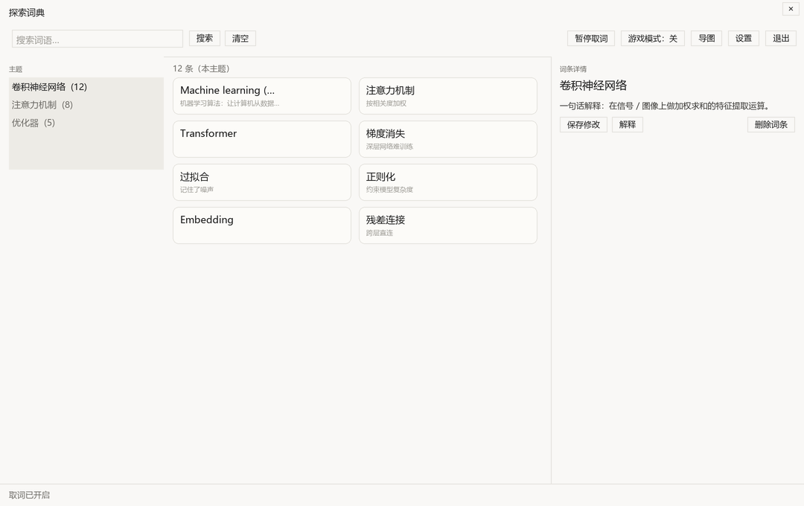
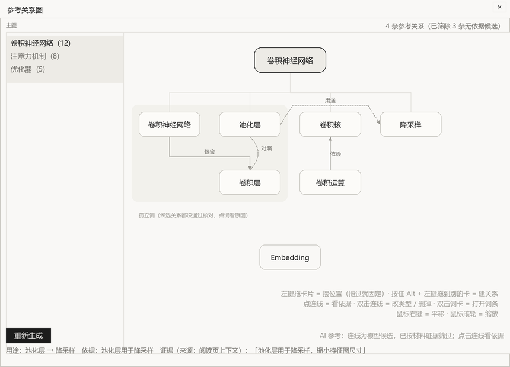

# 探索词典 · ExplorerDict

把「划词 → 原文阅读 → 资料整理 → 带依据的问答 → 学习计划」连成一条**本地优先**的学习链路。
Windows 桌面应用：原生划词取词 + 本地阅读工作区，词库、文章、笔记、计划与索引都保存在本机。

- 划词只在用户明确点击「解释并记录」后才调用模型；面板展开、标注、检索索引均在本机完成。
- 模型 API 由使用者自备，密钥经 Windows DPAPI 加密后仅存本机，仓库不含任何密钥与个人数据。




## 功能

| 模块 | 能力 |
| --- | --- |
| 划词与词条 | 全应用前台取词、幂等落库、自动解释、标签、合并/拆分、多格式导出、来源与上下文留存 |
| 原文阅读 | 导入文章、原文标注（荧光/下划线）、随文心得、引用定位、标记读完 |
| 资料库问答 | 本地语义 + 关键词混合检索、回答引用可回到原文、比较阅读、回答整理为笔记 |
| 全文导图 | 独立阅读 → 生成 → 复核三阶段；节点可查原句；导出 PNG / SVG |
| 学习空间 | 主题资料库、计划与对话式规划、今日概览、探索统计、内容管理 |
| 交互与外观 | 六套主题配色、明暗模式、窄屏响应式布局、悬浮取词 |

## 快速开始

**直接使用**：Windows 10/11 下运行 `探索词典.exe`（需与 `_runtime` 同目录）。阅读工作区入口在托盘菜单或主界面「阅读工作区」。

**从源码运行**：

```powershell
python -m venv .build-env
.build-env\Scripts\activate
pip install -r requirements-reading.txt
python bootstrap.py
```

- 运行环境：Windows 10/11、Python 3.12+（开发与验收使用 3.14.5）。
- 首次启动会引导配置模型服务（OpenAI 兼容接口），也可以先跳过、仅使用本地功能。
- 数据目录默认在项目内 `data/`，可在设置中更改存储位置。

**运行测试**：

```powershell
python -X utf8 -m unittest discover -s tests -t .
```

## 架构

```
bootstrap.py / desktop_entry.py   ← 启动与单实例、浮窗/主界面
app/                              ← 原生层：取词、UIA 桥、解释/问答服务、SQLite、Tk 界面
  ui/                             ← 主界面、浮窗、设置、导图与导出
app/workspace_server.py           ← 阅读工作区的本地 HTTP 服务（仅回环）
web/                              ← 阅读工作区前端（原生 JS，无框架依赖）
models/ + app/local_embeddings.py ← 离线向量模型与检索
tests/                            ← unittest 全量用例
```

- **三层边界**：原生壳负责取词与本地能力；本地 HTTP 服务提供阅读工作区接口；前端只经本机回环访问。
- **数据**：`explorer_dict.sqlite3`（词条/设置/密钥密文）与 `reading_workspace.sqlite3`（文章/笔记/计划/索引）分离存放，均在 `data/` 下。
- **模型调用**：统一的 OpenAI 兼容客户端，带超时、有限重试与请求归属校验；回答只引用检索到的片段，引用不合法时拒绝落库。

## 目录

```
app/            原生应用与本地服务
web/            阅读工作区前端
tests/          单元与界面测试
docs/
  参赛材料/     2.1 代码仓库与演进记录（原始 Prompt 链、优化稿、核对清单）
  验收记录/     各功能批次的验证记录
  设计预览/     离线界面预览
  开发日志.md   按时间累积的开发与验收日志（原 README 正文）
tools/          构建、验收与本地模型假服务脚本
```

## 验证与材料

- 全量测试：`python -X utf8 -m unittest discover -s tests -t .`；当前结果与已知失败项见 [2.1 材料核对清单](docs/参赛材料/2.1-材料核对清单.md)。
- 各批次验收记录：[docs/验收记录](docs/验收记录)。
- 参赛材料入口：[2.1 代码仓库与演进记录](docs/参赛材料/2.1-材料核对清单.md)、[提示词优化稿](docs/参赛材料/2.1-提示词优化稿.md)、原始对话 A/B/C。

## 隐私

本仓库不包含运行数据、日志、密钥或截图中的个人信息。使用时产生的数据仅写入本机 `data/`；除显式发起的问答/解释请求外，应用不向外部发送资料。

## 许可

MIT License，见 [LICENSE](LICENSE)。