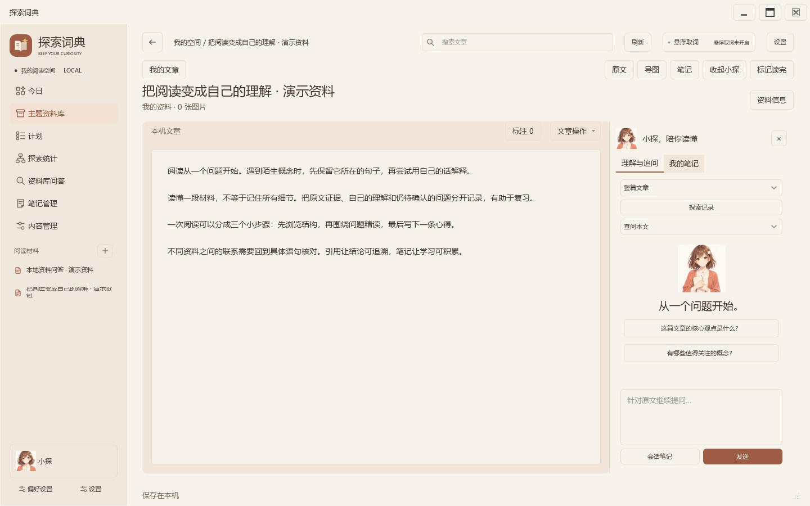
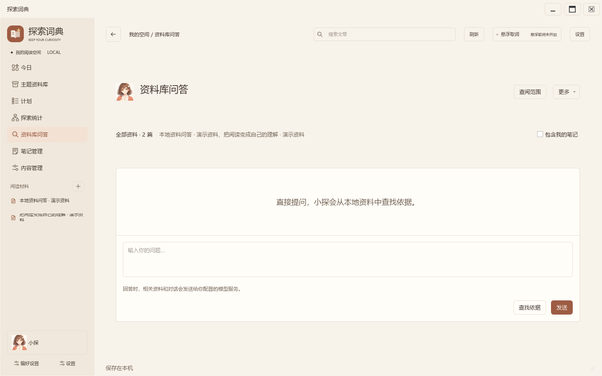

# 探索词典 · ExplorerDict

**边读边问，把划词、原文、笔记和计划留在同一个本地学习空间。**

Windows 原生桌面应用。主界面负责阅读与整理，悬浮窗负责跨应用划词；两者共用资料目录、模型配置和主题。

[快速启动](#快速启动) · [开发状态](docs/开发状态.md) · [作品资料](docs/参赛材料/README.md) · [技术文档](docs/参赛材料/技术文档.pdf) · [复现指南](docs/复现指南.md)

> 当前版本：**原生迁移试用阶段，2026-10-23**。主要模块已实现，完整交互还原、复杂资料及跨版本升级仍在继续验收。仓库源码与历史安装器并非同一版本，请以构建说明和开发状态为准。

## 在文章旁边，继续你的问题



打开文章后，通过“问本文”展开追问栏。可以围绕当前文章提问，也可以扩大到资料库；原文、标注和笔记留在眼前。

## 从本地资料中寻找依据



资料库问答默认查阅全部本地资料，后续导入的文章和抓取片段自动纳入。选择文件是可选的范围筛选，不是开始提问的前置步骤。抓取片段明确标为片段，不冒充文章全文。

## 阅读、记录、安排


- **导入与阅读**：多文件导入、文内查找与跳转、原文标注、阅读记录和随文笔记。
- **跨应用划词**：保存词语、上下文和来源，回到主界面继续理解。
- **本地 RAG**：文章使用关键词与本地向量混合检索；抓取上下文以片段参与关键词检索；回答附可核对引用。
- **学习整理**：主题资料库、计划、统计、内容管理和导图。
- **偏好记忆**：六套主题、明暗模式、保存天气城市；启动先恢复城市，再更新天气。
- **模型设置**：可编辑的模型选择、推理强度、预算滑轨及预设；API 密钥由用户自备，用 Windows DPAPI 保存。

截图由当前源码的真实原生窗口离屏渲染，使用自编演示资料，无个人数据、API 密钥或虚构模型回答。[截图来源与生成方式](docs/screenshots/native-20261023/README.md)

## 快速启动

Windows 10/11 x64，推荐使用开发环境对应的 Python 3.14。固定依赖见 [requirements.txt](requirements.txt)。

```powershell
git clone https://github.com/bsk865/ExplorerDict.git
cd ExplorerDict
powershell -ExecutionPolicy Bypass -File scripts/setup-repro.ps1 -SkipTests
.build-env/Scripts/python.exe native_desktop.py
```

无需 API 密钥即可导入、阅读和整理资料。使用模型问答时，在设置中填写接口地址、模型及密钥。下载依赖和向量模型耗时受网络影响，本版尚无干净机器启动耗时记录。

源码模式会启动原生阅读窗口；悬浮取词可通过源码子进程运行，UIA 辅助库由复现脚本编译。构建独立 EXE 见 [原生版构建与安装](docs/原生版构建与安装.md)。不需要运行旧版浏览器阅读入口。

## 代码导航

| 路径 | 用途 |
| --- | --- |
| `native_desktop.py`、`app/native/` | 当前原生主界面与页面控制器 |
| `bootstrap.py`、`app/ui/` | 悬浮取词与既有原生组件 |
| `app/workspace_store.py`、`app/db.py` | 阅读库、词条库和共享配置 |
| `app/library_assistant.py`、`app/retrieval.py` | 资料问答、引用、检索 |
| `app/request_supervisor.py` | 模型请求与有限重试 |
| `web/`、`reading_desktop.py` | 旧版阅读界面、共享主题资源与历史对照 |
| `tests/` | 自动检查；不同检查有不同环境要求 |
| `tools/`、`scripts/` | 构建、复现与开发工具 |
| `docs/开发状态.md` | 当前完成项、未完成项和下一阶段 |
| `docs/参赛材料/` | 作品技术文档、Prompt 链与演示资料 |

程序、数据库、运行日志、模型权重和个人交接文件不放入 Git 源码仓库。历史设计图与验收记录保留原日期，不作为当前界面或最新验收结果。

## 作品资料与开发过程

- [技术文档](docs/参赛材料/技术文档.pdf)：产品场景、架构、RAG 与引用设计。
- [AI 协作与代码演进](docs/参赛材料/2.1-材料核对清单.md)：三条完整 Prompt 链和对应提交。
- [复现指南](docs/复现指南.md)：环境配置、依赖安装和运行步骤。
- [资料导航](docs/参赛材料/README.md)：技术说明、过程记录与演示入口。

正式演示视频正在制作，当前界面可查看上方截图。
