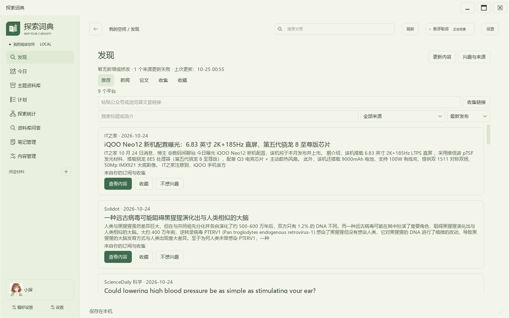
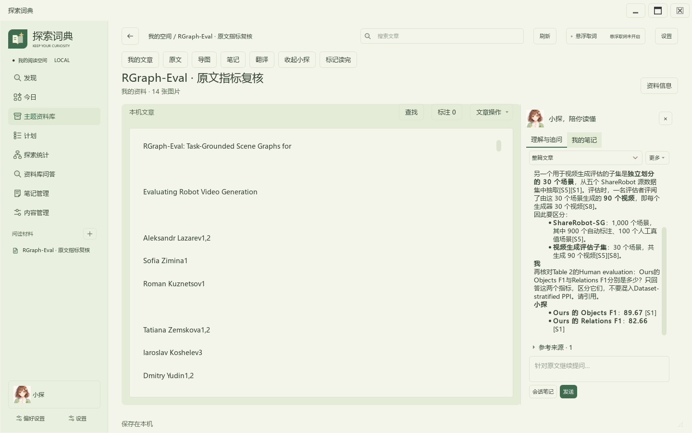
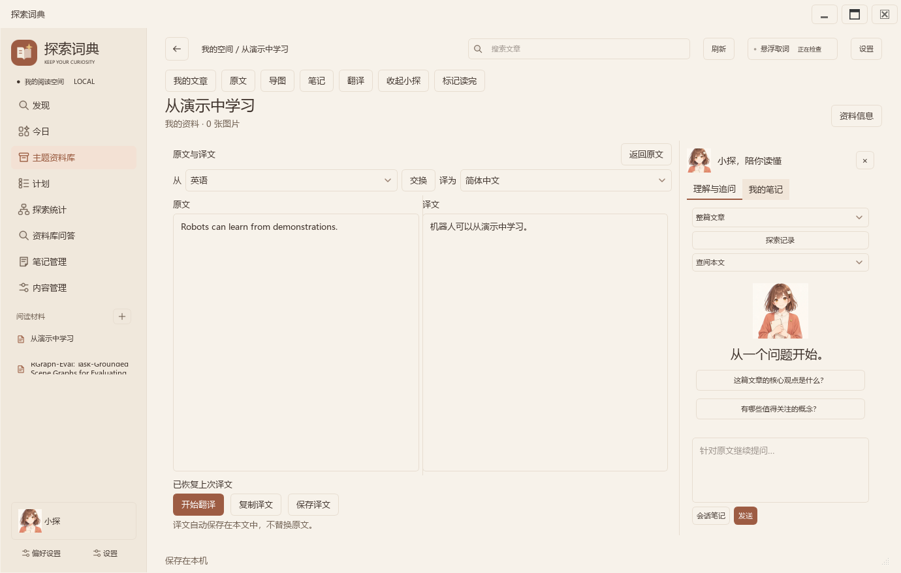
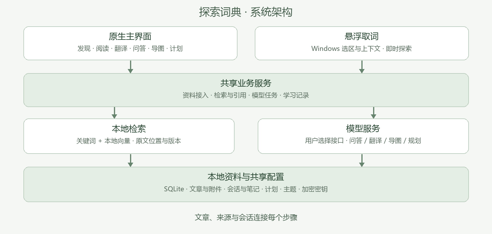

# 探索词典 · ExplorerDict

**从一次好奇开始，让发现、阅读和理解留在同一个空间。**

探索词典是一款 Windows 桌面学习工具。你可以收集新闻与论文，导入自己的资料，在文章旁提问和翻译，把理解整理成笔记、导图与学习计划。跨应用划词浮窗连接外部阅读与本地资料库，主界面和浮窗共用资料、模型配置及主题。

**[完整项目介绍（20页 PDF）](docs/项目资料/项目介绍.pdf) · [在线阅读](docs/项目资料/项目介绍.md)**：从 AI 时代的阅读背景、核心亮点到完整功能、使用方法、关键技术与实际开发记录。

[下载 Windows 版](https://github.com/bsk865/ExplorerDict/releases/tag/v1.0.20261025.3) · [使用指南](docs/使用指南.md) · [软件介绍](docs/软件介绍.md) · [技术文档](docs/项目资料/技术文档.pdf) · [开发指南](CONTRIBUTING.md) · [文档导航](docs/README.md)



## 适合怎样的阅读

- **课程学习**：把课程资料放进资料库，围绕概念追问，保留原句、标注和自己的理解。
- **论文研读**：收集公开论文，查阅全文与图片，对照翻译，通过引用回到原文。
- **专题探索**：从新闻、技术社区和论文发现线索，将不同来源整理为一个主题。
- **日常积累**：在其他应用阅读时划词保存，回到主界面继续理解，并安排后续学习。

## 让理解沿着原文生长

探索词典以文章作为阅读中心。问答、译文、笔记与导图随文章保存，读到哪里就能从哪里继续。回答提供可定位的来源，个人补充与原文依据分别呈现；资料和学习记录保存在本机，模型服务由你选择。

发现页结合兴趣和不同平台的内容，保留发现陌生方向的空间。六套配色、明暗模式和统一控件贯穿主界面与浮窗，让收集、阅读和整理形成连续体验。[了解设计理念](docs/软件介绍.md#设计理念)

## 从发现，到自己的知识

| 功能 | 你可以完成的事 |
| --- | --- |
| 发现与订阅 | 浏览新闻和论文，管理来源、兴趣、收藏与关键词；按最新发布排序，集中查看本次更新 |
| 全文阅读 | 导入 PDF、DOCX 与文本，收集网页和公开论文；查找原句、浏览图片、标注与记笔记 |
| 文章翻译 | 选择源语言和目标语言，对照阅读；每篇文章分别保存译文和翻译进度 |
| 资料问答 | 围绕本文或整个资料库提问，查看引用并回到对应原句；支持图片选区理解 |
| 导图整理 | 生成有原文依据的导图，编辑节点、层级、关系和布局，导出完整内容 |
| 学习安排 | 从自然语言需求生成学习计划，处理日程冲突，查看待办和完成记录 |
| 跨应用划词 | 保存词语、上下文与来源，在浮窗理解，再回到主界面继续整理 |





## 开始使用

当前版本 **1.0.20261025.3**，支持 Windows 10/11 x64。

1. 从 [Releases](https://github.com/bsk865/ExplorerDict/releases/tag/v1.0.20261025.3) 下载 `ExplorerDict-Stage-1.0.20261025.3-Windows-x64.zip`，解压整个目录。
2. 双击 `探索词典-原生版.exe`。可先导入资料，体验阅读、标注、笔记与分类。
3. 使用问答、翻译和导图时，在设置中填写模型接口、模型、推理强度与 API 密钥。

免安装包包含运行环境及本地向量模型。资料默认保存在程序目录的 `data` 中，可在设置里更改位置。联网模型功能会向你选择的服务发送相应的问题和材料。[使用指南](docs/使用指南.md) · [数据与模型](docs/信息存储与上下文说明.md)

## 如何实现



主界面采用 Python 与 PySide6，悬浮取词组件通过 Windows 辅助功能接口读取选区。两个入口共用本地资料目录，业务服务负责文章、问答、翻译、导图和计划，SQLite 保存资料、会话与设置。

资料问答结合关键词和本地向量检索，选出相关片段后交给配置的模型，回答引用再回到文章。网页与订阅读取保留来源信息，图片封面采用原站资源；用户选择全文加入后，文章进入资料库。

[技术设计](docs/项目资料/技术文档.md)与[PDF](docs/项目资料/技术文档.pdf)共19章，覆盖全部主要功能、架构与数据模型、混合检索、任务恢复、桌面联动、Prompt设计及三条实际开发案例。各章附主要实现模块，便于从功能查到代码。

## 开发与运行

开发环境为 Windows、PowerShell 和 Python 3.14。准备脚本安装固定依赖、下载并核对向量模型、编译取词辅助库。

```powershell
git clone https://github.com/bsk865/ExplorerDict.git
cd ExplorerDict
powershell -ExecutionPolicy Bypass -File scripts/setup-repro.ps1 -SkipTests
.build-env/Scripts/python.exe native_desktop.py
```

[完整环境与运行步骤](docs/复现指南.md) · [源码运行记录](docs/源码环境运行记录-20261025.md) · [环境变量示例](scripts/repro-env.example.ps1) · [构建方式](docs/原生版构建与安装.md)

开发采用“场景需求 → 模块实现 → 实际交互反馈 → 定向修复 → 阶段交付”的流程。需求、设计决定和代码变化在[开发过程](docs/项目资料/开发过程.md)中串联，原始协作记录与 Git 提交历史一并保留。

| 目录 | 内容 |
| --- | --- |
| `app/native/` | 主界面、阅读与页面控制器 |
| `app/ui/` | 悬浮取词与桌面组件 |
| `app/` | 资料管理、检索、模型调用和学习服务 |
| `tests/` | 各模块与交互检查 |
| `tools/`、`scripts/` | 构建、运行准备与开发工具 |
| `docs/` | 使用说明、技术设计、开发记录与界面示例 |
| `web/` | 共享主题资源与早期阅读界面 |

## 参与项目

欢迎通过 [Issues](https://github.com/bsk865/ExplorerDict/issues) 提交问题或想法，也可以按[贡献指南](CONTRIBUTING.md)提交修改。[版本进展](docs/开发状态.md)集中记录当前版本和后续方向。

项目源码采用 [MIT License](LICENSE)。文档中的公开文章、论文及其图片保留原始来源信息，内容权利归各自作者和来源方。
