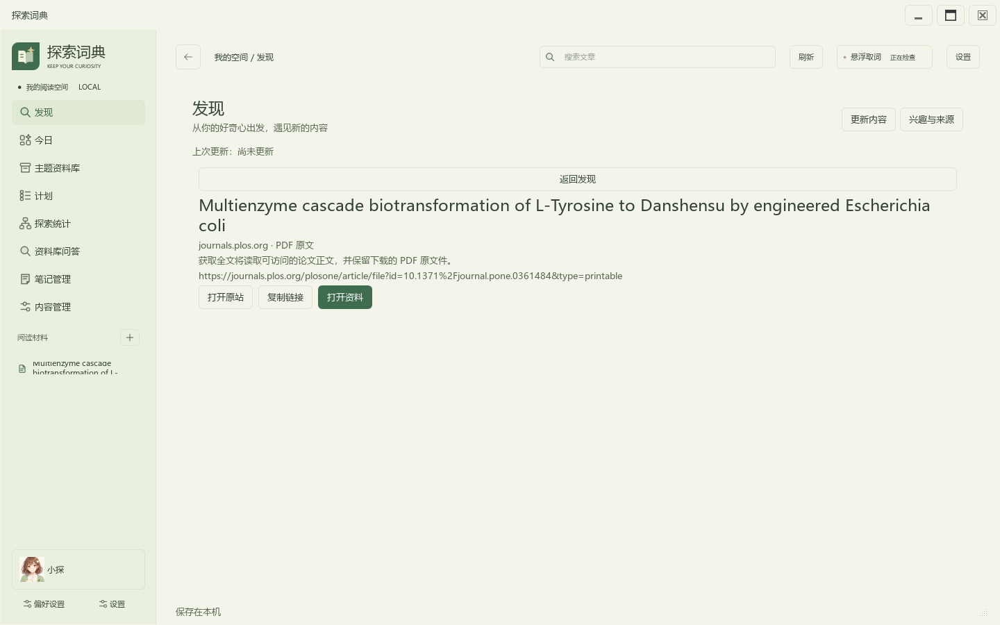
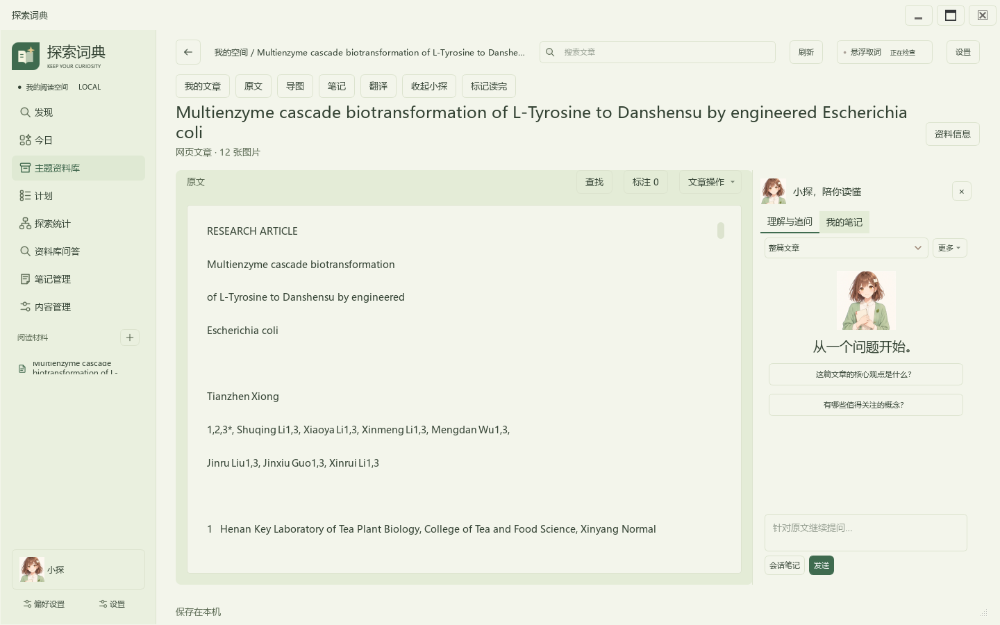
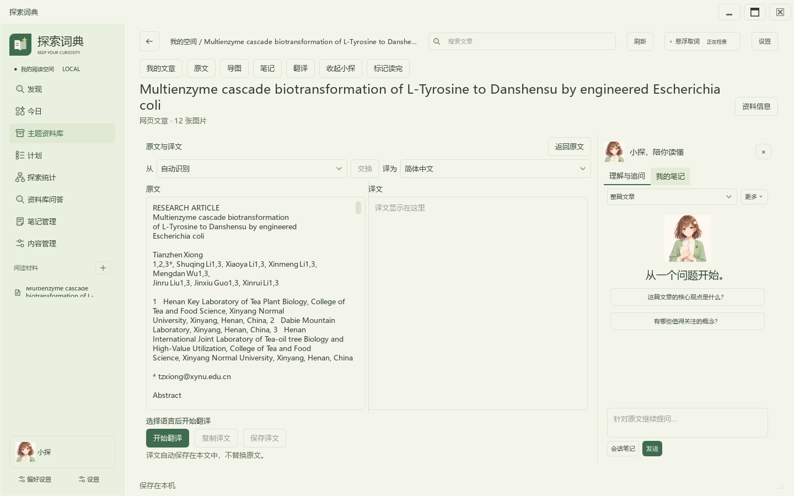

# 链接收集与全文阅读

公开PDF可以先加入“收集”，再获取全文进入阅读与问答；没有摘要时只提供实际可用的操作。相同正文从不同入口加入时，继续使用原文章及其译文。

本例使用PLOS ONE论文“Multienzyme cascade biotransformation of L-Tyrosine to Danshensu by engineered Escherichia coli”，DOI：[10.1371/journal.pone.0361484](https://doi.org/10.1371/journal.pone.0361484)。由期刊原站下载1,011,271字节、12页PDF，提取39,998字符，原文件按字节保留。来源内容及权利归原作者和期刊所有。

翻译位于文章工具栏，本图未请求翻译。截图来自1440×900原生窗口的离屏渲染，只含上述公开论文。复现脚本为 `tools/capture_source_links.py`：每次下载一次原件，复用响应完成网页链接与发现页收集流程，不读取私人文章、不发送模型请求。

合成资料检查另覆盖arXiv地址、论文详情页跳转后的相对PDF地址、文件损坏或加密、下载失败保留旧文章及译文，以及相同正文再次加入后的译文保留。这些检查不代表所有出版商页面或全部功能已经验收。
