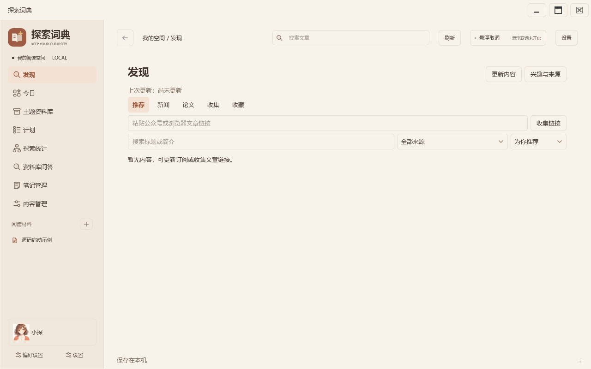

# 源码环境运行记录 · 2026-10-25

本记录说明源码准备和独立启动检查的实际结果。程序功能基线为`3049488`；最终启动检查使用源码`18833ba`，包含后续准备脚本及检查工具修订。现有免安装包版本仍为1.0.20261025.3。

## 环境与前提

| 项目 | 本次条件 |
| --- | --- |
| 系统 | Windows11 x64，10.0.26200 |
| 解释器 | 已安装CPython3.14.5 x64；Windows PowerShell5.1 |
| 源码 | 从本机Git仓库独立克隆，随后快进到字体修订提交 |
| Python环境 | 在独立源码目录新建虚拟环境；后续直接运行复用已安装依赖 |
| 包源与缓存 | 清华PyPI镜像、已有用户缓存；部分依赖重新下载 |
| 向量模型 | 首次尝试使用空模型目录；下载失败后使用同日已下载、SHA256一致的文件 |
| 应用资料 | 新建独立资料目录，自编文章，无用户数据或API密钥 |

`requirements.txt`固定直接依赖版本；本次实际安装的全部Python包见[依赖快照](运行记录/20261025-source/requirements-resolved.txt)。模型固定revision和摘要见[源码运行指南](复现指南.md#依赖与本地模型)。

## 实际用时与结果

下表按各次操作独立计时，下载失败和后续恢复分别记录。

| 操作 | 秒数与结果 |
| --- | --- |
| 独立本机克隆 | 4.906秒，成功 |
| 新环境准备、依赖安装与模型下载尝试 | 504.786秒，依赖安装完成，模型下载发生传输EOF错误 |
| 上述整次尝试 | 509.794秒，未完成准备 |
| 使用已校验模型后直接运行准备命令 | 1.456秒，依赖与模型核对、UIA构建成功 |
| 最终独立启动检查进程 | 3.450秒，成功；工具内部初始化至截图为2.799秒 |

依赖下载中出现过超时续传。自动日志重定向下的编译重试还遇到资源文件写入失败；按指南直接调用PowerShell后构建通过。准备脚本的路径、摘要计算和临时构建位置修订保留在Git历史中。

这些数值描述本机已有系统、Python和部分下载缓存的条件。源码网络取得、全新电脑安装与不同网络的耗时需要另行测量；首次下载失败也保留在[网络尝试结果](运行记录/20261025-source/network-attempt.json)中。完整免安装包可按[10分钟快速体验](复现指南.md#10分钟快速体验)直接使用。

## 成功执行的命令

独立源码目录已具备依赖和模型后，直接执行：

```powershell
powershell -NoProfile -ExecutionPolicy Bypass -File scripts/setup-repro.ps1 -SkipTests
.build-env/Scripts/python.exe -X utf8 tools/check_repro_startup.py --output artifacts/source-startup --offscreen
```

如默认`python`不是3.14 x64，使用`-PythonCommand`指定实际解释器。下载不稳定时可重新执行准备脚本，或使用`-ModelMirror https://hf-mirror.com`；已有文件经摘要核对后复用。模型目录为`models/multilingual-e5-small/`，其中直接放置`model_quantized.onnx`和`tokenizer.json`。

## 本次检查覆盖

- UIA辅助库构建后可加载。
- 本地ONNX模型实际编码，输出形状为`(1, 384)`。
- 自编文章导入后，由新的存储对象重新读取，正文一致。
- 原生主界面建立页面并生成中文截图，使用离屏平台。
- 模型API调用次数为零，未启动外部划词进程。

本次检查用于确认源码环境、渲染与本地保存链路。模型问答、发现联网更新和跨应用选区操作应在配置相应服务后按使用指南体验。详细机器结果见[result.json](运行记录/20261025-source/result.json)。



[源码运行](复现指南.md) · [技术设计](项目资料/技术文档.md) · [构建与安装](原生版构建与安装.md)
