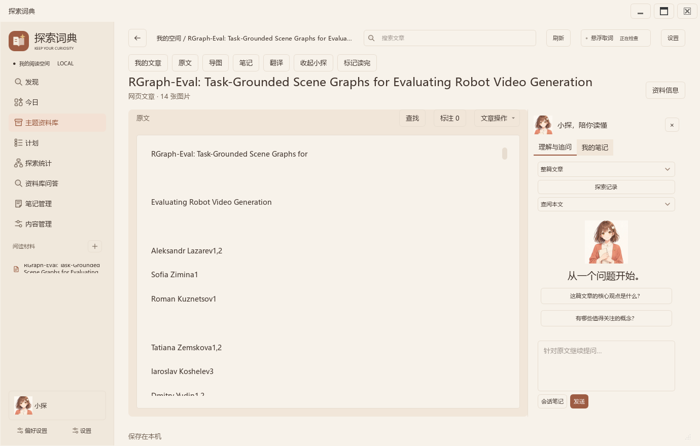
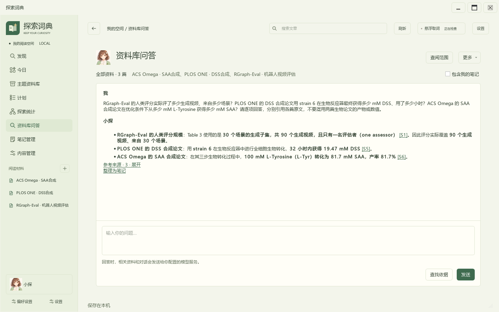
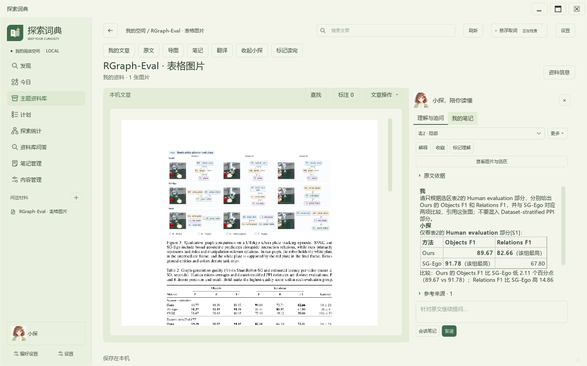
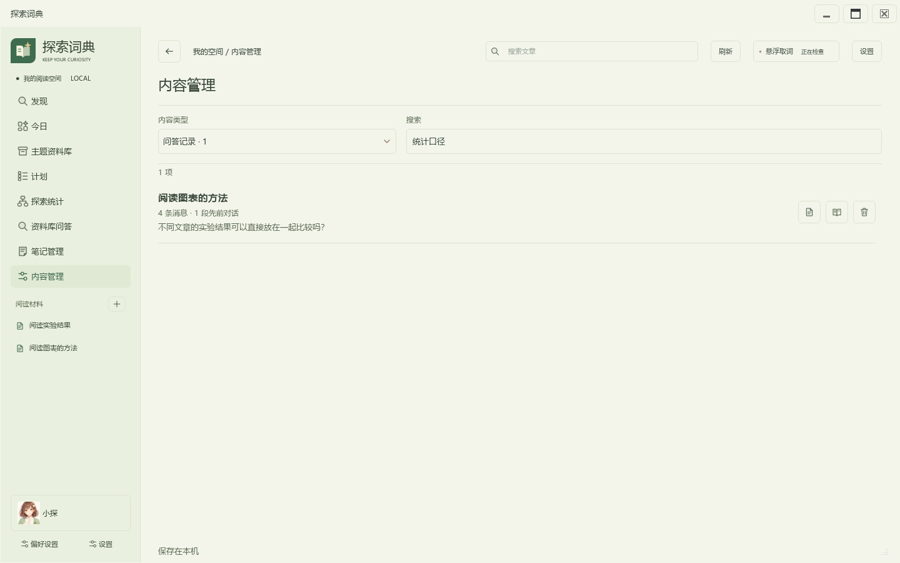
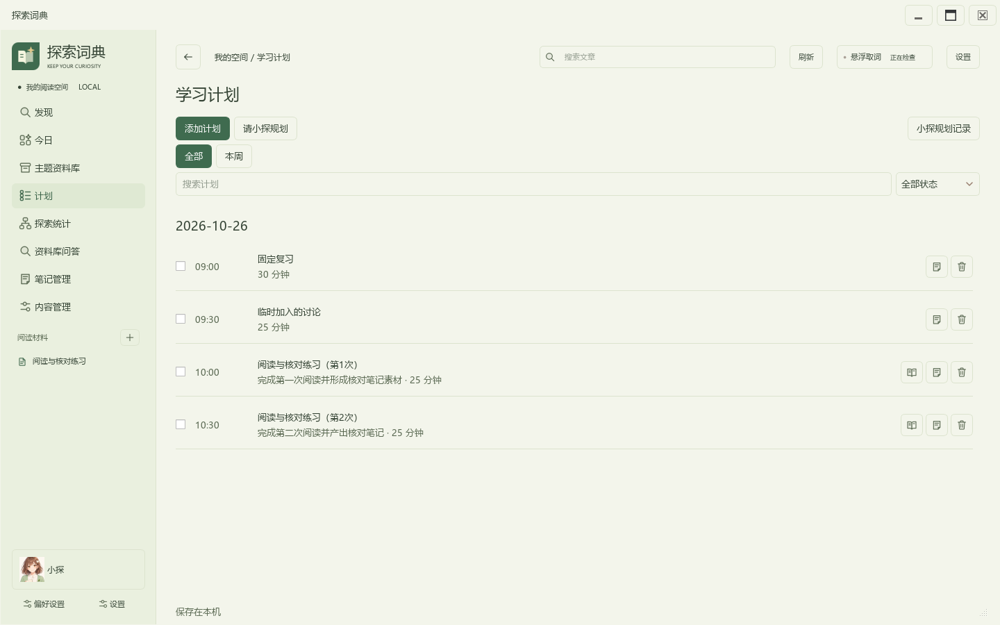
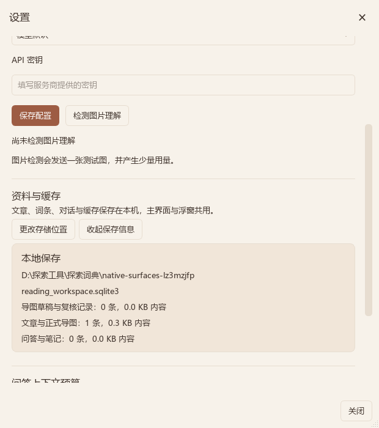

# 探索词典

让每一次阅读，都能成为下一次探索的起点

从发现一篇文章，到读懂、追问、整理与继续学习。探索词典把 AI 放进阅读过程，让原文、问题和自己的理解始终有联系。

[GitHub 仓库：https://github.com/bsk865/ExplorerDict](https://github.com/bsk865/ExplorerDict)

发现线索 → 全文阅读 → 随文追问 → 整理理解 → 继续学习

### 读到哪里，就问到哪里
保留文章、选区和上下文，让问题有具体来处。

### 理解之后，仍能回到原文
引用定位、版本关联和个人笔记共同保留理解过程。

### 一次阅读，留下可复用的成果
译文、导图、笔记与学习任务继续随资料积累。

Windows 桌面应用 · 1.0.20261025.3 · 2026-10-25
面向学习者、研究者与持续探索某一主题的读者。

## 先看六个值得体验的亮点

阅读不止是得到一个答案。探索词典希望帮助读者保留问题出现的位置，看清答案的依据，再把理解变成自己的知识。

### 01 文章旁边，就是问答入口
无需先到另一处选择文件。打开文章即可提问，资料库中的其他文章也可按需参与。

### 02 AI回答能够返回原句
问答携带本次材料的引用，点击回到文章位置；多篇资料可以分别提供依据。

### 03 译文真正属于这篇文章
语言、译文和进度按文章保存。原文与译文对照，长文可以停止和继续。

### 04 图表与结构也能进入理解
图片框选提问、图文导图、节点与关系的原文依据，把文字之外的信息纳入阅读。

### 05 读完以后，成果留得下来
标注、心得、问答依据和译文可导出；导图可以编辑、调整层级并完整导出。

### 06 内容发现能够接上后续学习
多源新闻与论文、全文入库、主题整理和学习计划连接起来，关注线索可以持续跟进。

### 它们如何协同

在发现页遇到一篇值得读的论文，获取全文后边读边问；遇到外文段落时翻译，遇到图表时框选；阅读结束后导出笔记、整理导图，并为下一次阅读安排任务。每一步沿用这篇文章的身份与来源。

阅读顺序：背景与问题（第3–4页）→ 产品思路与完整功能（第5–15页）→ 技术、开发实践与使用（第16–20页）。

## AI时代，阅读入口正在改变

读者越来越容易接触一条信息；从信息中形成可靠、持续的理解，仍然需要主动选择、核对与整理。

### 从网站与文档，扩展到信息流和对话

Reuters Institute《Digital News Report 2025》覆盖48个市场。其样本中，18–24岁受访者有44%把社交媒体和视频网络作为主要新闻来源；使用 AI 获取新闻的每周比例总体为7%，25岁以下为15%。[R1] 阅读的入口因此可以是推送、摘要、短内容或一个直接提出的问题。

44%：18–24岁样本：社交与视频为主要新闻来源
7% / 15%：每周用AI获取新闻：总体 / 25岁以下

### 得到答案更快，回到来源却未必更容易

Pew Research Center 对900名美国成年人的浏览行为进行分析：在出现 AI 摘要的 Google 搜索访问中，传统搜索结果链接的点击比例为8%；没有 AI 摘要时为15%。摘要自身来源链接的点击比例为1%。[R2] 这项观察提示，理解工具需要主动保留通向原文的入口。

### 读者需要效率，也需要掌握理解过程

同一份 Reuters 报告显示，样本对摘要、跨语言翻译等用途有兴趣，也有人担心个性化选择会遗漏重要内容，并更接受人仍参与其中的 AI 应用。[R1] 因此，辅助阅读应同时提供解释、来源和自主选择的空间。

### 产品判断
探索词典围绕“发现—原文—提问—核对—整理”组织功能，把 AI 的解释能力连接到可继续查阅的资料。

以上为2025年特定市场与样本的公开观察，不代表全部中国读者或所有阅读场景，也不是本项目的效果测量。完整来源见第20页。

## 从阅读中的问题，找到AI合适的位置

产品把目标聚焦在需要反复阅读、理解概念或比较资料的场景。下面的问题来自这类工作流的具体动作，用来解释功能为什么这样组织。

| 阅读中的阻力 | AI能够提供的帮助 | 探索词典的落点 |
| --- | --- | --- |
| 信息散在不同入口，值得精读的内容容易丢失 | 按兴趣帮助筛选线索，以更便于浏览的方式组织内容 | 多源发现、来源筛选、收藏与链接收集；确认后获取全文 |
| 遇到术语或疑问，来回切换打断阅读 | 结合当前段落和上下文解释、追问 | 跨应用划词、文章侧栏问答、选区与所属文章关联 |
| 回答看起来完整，却难判断依据 | 结合检索材料回答，并指出结论的出处 | 本地资料检索、原文引用与定位、多文献分别提供依据 |
| 外文和图表增加理解门槛 | 语言转换、选定图片区域的解释、图文联合研读 | 文章内翻译、图片框选问答、正文或图文导图 |
| 读完有印象，却缺少可回看的结构 | 提取信息、组织结构、提出后续学习安排 | 可编辑导图、随文笔记、成果导出与学习计划 |

### 让AI承担辅助，让读者保留判断

模型擅长语言解释、跨语言表达、结构整理和对话式协助；检索、对象关联、版本核对及保存由本地业务规则承担。回答可以核对原句，导图可以查看依据，学习计划经确认后保存，用户自己的补充有清楚的身份。

### 设计目标
降低理解与整理的操作负担，同时保留读者接触原文、提出新问题和形成自己观点的过程。

## 用一条完整阅读路径理解产品

以“持续了解具身智能”为例：一条新闻只是起点，真正有价值的是沿着问题读下去，并留下可继续使用的资料。

发现 → 接入 → 理解 → 整理 → 行动

### 01 / 发现线索
选择科技新闻、科学传播或开放论文来源，填写兴趣方向，查看最新发布和本次更新，收藏值得跟进的条目。

### 02 / 取得阅读材料
在详情里获取全文，或导入自己合法取得的 PDF、DOCX 与文本；文章进入主题资料库并保留来源。

### 03 / 围绕疑问继续读
在原文旁提问，点击引用核对；翻译需要的外文，框选关心的图表，再用资料库问答比较其他文章。

### 04 / 留下自己的理解
标注关键句，记录心得；生成并编辑导图，把确认过的问答内容保存为笔记，导出完整阅读成果。

### 05 / 安排下一次学习
描述目标和可用时间，确认关联资料与安排，在今日和任务记录中继续推进。

### 文章是贯穿各环节的共同对象

文章身份、来源、版本和原文位置把翻译、会话、导图、笔记与计划连接起来。主题用于组织多篇资料；问答和探索记录保留各自上下文。功能切换之后，已经形成的阅读成果仍然有明确归属。

本页为使用场景示例，说明现有功能的组合方式，不是用户研究或学习效果实验。

## 发现：让值得读的内容持续出现

新闻、论文与主动收集的链接进入同一处。用户既可以关注熟悉方向，也可以选择其他来源拓展视野。

### 按自己的方向浏览
本机兴趣结合导入资料与探索线索安排推荐；可以设置兴趣、屏蔽词、来源启停和收藏。

### 关注更新，也看见差异
更新分别统计新增和修改；“本次更新”集中呈现发生变化的内容，“最新发布”优先查看较新的条目。

### 保留原站的内容身份
封面来自订阅或原网页；保留标题、来源、发布时间与可用论文信息，预印本标明其身份。

### 控制内容入口
支持 RSS/Atom 与公开链接收集，可查找网站订阅；同平台栏目共同参与交错，减少单一来源占据列表。

默认订阅覆盖科技新闻、社区、科学传播和开放论文。公众号采用公开文章链接接入；浏览器通过复制链接接入，当前版本不包含浏览器扩展。

## 全文接入与阅读：把资料真正留下来

### 多种资料进入同一阅读流程
导入 PDF、DOCX、文本，或直接粘贴内容；公开网页、PDF 链接、arXiv 和可访问的论文详情页共用全文接入。

### 全文与摘要各有身份
选择获取全文后才按全文保存；摘要单独标识，可以继续取得全文。论文 PDF 原件可在资料信息中另存。

### 阅读细节服务于理解
支持文内查找、阅读位置、原句标注、随文心得、图片浏览和公式展开。图像可缩放拖动，公式可在文章内放大后返回。

### 组织自己的专题资料
文章归入主题，保留来源和版本；相同正文重复接入复用已有资料，译文与阅读状态继续跟随所属文章。

### 从链接到可继续阅读的文章
内容取得之后，问答、翻译、导图和笔记沿用同一篇资料，不需要在每个工具里重复导入。

登录、付费、验证码或不可读取的页面可返回原站，或导入自行合法取得的文件。扫描页可保留图像，图文理解需要相应模型能力。

## 边读边问：让解释贴着原文发生

遇到一段难懂的文字，直接在文章旁提出问题；看完回答，再回到原句继续读。

### 直接从文章开始
“问本文”默认围绕当前文章查找依据，选区和阅读位置帮助限定问题；也可以扩大资料范围。

### 让依据可见、可返回
回答引用关联实际片段，点击定位并高亮原句。文章改动后核对版本，历史会话保留回答当时的依据。

### 保留对话，也保留阅读
文章旁继续追问，已有消息和草稿按所属会话保存。确认有用的内容可以另存为笔记，与原文继续关联。

### 可以怎样问
“这里的实验前提是什么？”“作者说的限制出现在哪一段？”“这张图与正文的结论有什么联系？”

问题示例仅演示提问方式；具体回答由所选模型与当前可取得的材料共同决定。

## 资料库问答：把分散资料放到一起理解

资料积累后，问题常常跨越一篇文章。资料库问答默认查阅已经入库的材料，新增文章自动纳入；可以按文章或主题缩小范围，也可以选择多篇文章进行比较。

### 同时查找术语与相近表达
关键词检索与本地向量检索共同寻找相关片段，再把问题和本次证据交给模型。

### 多个问题分别找依据
比较阅读为不同资料保留候选和引用，减少某一篇材料覆盖其他资料的机会。点击引用返回相应原句。

### 原文与个人理解各自保留
可以纳入个人笔记，但笔记身份与原文区分；回答历史保留当时的材料快照，便于之后核对。

截图复用2026-10-24已保存的真实问答，输入为公开资料。详情和引用定位截图见源码 docs/screenshots/multi-public-rag-20261024/README.md。

## 翻译：读哪篇，就保存哪篇的译文

翻译是阅读中的工具。选择源语言与目标语言，在文章里对照理解，稍后回来仍能接着读。

### 语言方向由用户选择
源语言支持自动识别，也可明确指定；目标语言可选择中文、英语、日语、韩语及其他已提供语言。

### 译文与文章一一对应
语言、输入、译文和进度按文章保存。发现摘要与浮窗文字使用自己的来源身份，避免切换资料时混用。

### 长文能够分段继续
按段落或句子边界组织任务，完成部分即时保存；可停止、继续、复制或导出，恢复时核对原文与语言身份。

### 一个连贯动作
先阅读原文 → 翻译所需内容 → 对照核对概念 → 回到本文问答继续追问 → 将译文随阅读笔记导出。

支持的语言入口不等同于每种语言均已完成质量评测。当前实际请求示例与来源见源码 docs/screenshots/reading-tools-20261024/README.md。

## 图文理解：让图表也成为提问的对象

### 把问题落到具体图像区域
图片支持适应窗口、放大、拖动与框选。用户选定整图或局部后发起理解，区域随所属文章保存。

### 图像与提问保留关系
选区按原图坐标记录，窗口变化仍能对应。打开所属图片会话继续追问，回答中的图片依据仍可查看。

### 为不同资料选择合适方式
文字型材料可用正文阅读和正文导图；扫描页或图表重要的资料可选择图文模式，结合图片与正文研读。

### 处理阅读中常见的复杂内容

文章里的长公式可在页内放大查看，表格和图片保留在资料中。图片理解使用所选模型的视觉输入能力，用户可在设置中进行实际能力检测，再决定是否使用图文任务。

该表格案例使用公开论文的605×252像素选区实际生成回答，未向模型提供全文。来源记录见源码 docs/screenshots/image-reading-20261024/README.md。

## 导图：把理解变成可修改的知识结构

### 从资料生成，而后返回资料
支持正文和图文依据。先研读记录信息与引用，再组织草稿、对照原文复核；节点或关系可以查看依据并返回文章。

### 用户能够继续改
编辑节点文字、新增或删除分支、调整上级、增加关系、拖动布局；支持撤销、恢复布局或恢复生成版本。个人补充带有标记。

### 大图分层看，成果完整带走
主题概览与分支浏览帮助阅读长图；缩放、拖动画布和自适应调整视野。导出完整 PNG、SVG 或含节点、关系、依据的 Markdown。

### 长资料保留进度
分段研读与检查点保存已完成内容；中断后按输入身份恢复，新结果通过后再替换正式导图。

### 从自动整理走向主动理解
生成一张图只是开始。查看每条关系的依据、调整结构并写入自己的补充，才能把文章组织成可继续使用的学习材料。

## 笔记与记录：让读过的内容找得回来

### 随文记录自己的判断
原句标注、对象笔记、随文心得和确认过的问答内容，都能保留所属文章、位置与来源身份。

### 统一查找阅读痕迹
内容管理覆盖文章、笔记、问答、导图、主题、计划、标注和草稿。查看记录后可返回来源，再回到保留筛选状态的列表。

### 区分事实与个人理解
文章原句、历史回答、个人笔记和手动导图补充各自有身份；资料版本变化时有据可查。

### 一份文件带走阅读成果
阅读笔记导出为 Markdown，汇集本文章的原文、标注、心得、问答及引用和译文；导图另可输出图形与结构文本。

这些记录使一次阅读成为后续问题的上下文。重新打开文章，可以查看当时提出过什么、依据在哪里、哪些理解已经写入笔记，以及还有哪些问题等待继续。

删除操作展示关联影响：主题整理、独立笔记、会话和文章按各自规则处理。备份时退出程序并复制完整资料目录。

## 学习计划：把兴趣接到下一步行动

“我想继续了解这个主题，每天有半小时。”目标、可用时间和已有资料，可以一起转化为待确认的学习安排。

### 用自然语言表达需求
结合当前日期、可用时段、已有任务与资料提出安排，包含具体产出、开始时间、用时和可选文章关联。

### 时间安排有本地核对
保存前检查范围、资料归属和日程冲突；生成期间发生变化时，保留任务内容与时长，读取新日程重新安排。

### 看得见后续进度
确认后整批保存，查看待办与完成记录，返回关联文章继续学习；今日和探索统计集中呈现任务数量与进度。

今日页同时提供日期、天气与待办，城市选择持续保存。计划使关注方向拥有可执行的下一步，也让阅读、整理与实际投入的时间建立联系。

截图来自2026-10-25实际模型规划与冲突处理案例；两次请求完成安排，未使用用户文章。具体条件与结果见对应截图目录 README。

## 桌面协作：在不同入口继续同一份探索

悬浮窗承接外部选区与即时探索，主界面承接完整阅读与学习整理；两者共享资料目录、模型配置和主题偏好。

外部应用里的一次选词，可以先获得即时解释并保存探索线索；需要全文和系统整理时，回到主界面继续。主界面与浮窗分别承担适合各自窗口的任务，共享持久化资料、模型配置与主题。

### 视觉语言保持一致
共享六套配色和明暗模式。按钮、表单、文件面板与确认面板采用应用主题；文章工具嵌入当前流程。

### 偏好为下次使用保留
模型与推理强度、问答预算、资料位置、外观与天气城市持久保存。两个入口按各自刷新周期读取共同设置。

### 同步对象与窗口状态分开管理
保存的资料可以继续使用；当前页面、临时草稿和窗口内编辑分别归属各自交互。共享设置不等于强制两个窗口显示同一页面。

## 技术如何支撑完整体验

| 技术环节 | 做法与用户可感知的作用 |
| --- | --- |
| 原生桌面与业务服务 | Python / PySide6 主界面，独立浮窗进程；复用共享服务，使资料和配置保持关联。 |
| 本地混合检索 | 关键词与 multilingual-e5-small 量化 ONNX 向量召回融合；在本机寻找问题相关的文章片段。 |
| 文章与版本模型 | SQLite、附件、对象身份与原文位置关联；支撑引用、译文隔离、历史回看和导出。 |
| 任务与网络管理 | 前台优先、相同请求合并、预算内重试、停止与检查点；长任务保留有效进度。 |
| 生成结果的本地规则 | 校验引用、结构、任务时间与资料归属；有效结果按文章或会话保存。 |

本地向量模型承担检索编码；用户配置的生成模型承担回答、翻译、图文理解、导图和规划。两者的职责与运行条件分别说明，模型名称和推理强度可由用户设置。

本页用于解释产品实现。更详细的模块、数据流、模型任务及源码位置见随包22页技术设计。

## AI开发与测试实践，有记录可追溯

项目采用用户需求与 AI 协作推进开发：提供使用场景、相关代码和反馈，围绕数据归属、界面动作与保存结果完成实现和定向修复。AI 也用于故障分析与检查补充，实际运行结果继续决定修改是否成立。

| 公开协作链 | 从问题到落地 |
| --- | --- |
| 资料库与RAG · 32条 | 从资料管理需求进入本地检索、文章关联与引用，继续处理反馈中的查阅与界面问题。 |
| 预读与请求管理 · 33条 | 从等待过长追踪到排队、传输、取消与重试，形成统一请求管理与有效进度恢复。 |
| 学习规划 · 81条 | 从自然语言目标、界面可读性到计划保存、完成进度与日程冲突处理。 |

### 应用中的模型输出，也经过规则检查

问答核对本次引用和原句，导图分阶段研读与复核后校验结构，计划检查日期、时间、资料与冲突。模型帮助生成和复核，本地代码约束可保存的结果，用户继续查看原文并确认安排。

### 已有的实际记录

| 记录类型 | 可查看的实际内容 |
| --- | --- |
| 真实模型案例 | 公开资料的多文献回答、图片表格选区、短句翻译，以及隔离示例资料的日程冲突重排。 |
| 源码环境检查 | UIA辅助库加载、本地384维向量编码、文章导入后重读、原生窗口中文离屏渲染。 |
| 开发检查与原始材料 | 源码 tests/、截图来源、146条连续公开消息、附件和摘要索引；保留下载失败与恢复的实际记录。 |

各项记录说明对应条件下的实际流程。不同模型、资料和电脑的具体使用结果，仍需按所选环境体验与核对。

## 从下载到第一次完整体验

### 01 / 完整解压并启动
Windows 10/11 x64。解压免安装 ZIP 中全部内容，双击“探索词典-原生版.exe”。运行环境和本地向量模型随包提供，无须另装 Python。

### 02 / 导入一份自己的材料
用 PDF、DOCX、文本或公开链接建立第一篇文章，尝试查找、标注与随文笔记，确认资料保存位置。

### 03 / 按需配置模型
在设置中填写自己的服务接口、模型、推理强度和 API 密钥。需要图片理解时，选择支持图片输入的模型并检测。

### 04 / 完成一次读与问
打开“问本文”，提出一个明确问题，点击回答引用核对原句；尝试文章翻译与笔记保存。

### 05 / 整理并留下下一步
生成导图后查看依据并编辑，导出阅读笔记或完整导图；为后续阅读创建学习任务。

| 使用条件 | 涉及的功能 |
| --- | --- |
| 本地即可开始 | 已有文件导入、原文阅读、标注、笔记与保存记录查看；本地向量检索使用随包模型。 |
| 需要网络来源 | 订阅更新、封面与公开网页取得、天气；能否取得全文取决于来源访问条件。 |
| 需要自己的模型配置 | 问答、翻译、导图与学习规划；图文任务还需要对应模型的图片能力。 |

移动软件时保留完整程序目录。密钥使用 Windows DPAPI 保存；换电脑后重新配置。备份先退出主界面与浮窗，再复制完整资料目录。

## 功能覆盖与当前交付范围

| 环节 | 当前提供的能力 | 形成的资料 |
| --- | --- | --- |
| 发现 | 新闻与论文、来源与兴趣、最新与更新、收藏、公开链接收集 | 来源、线索与收藏 |
| 接入 | PDF / DOCX / 文本、公开网页、论文全文、可用原件 | 文章、版本与附件 |
| 阅读 | 查找定位、阅读位置、标注、图片与公式 | 阅读上下文与标注 |
| 问答 | 问本文、全库范围、多篇比较、原文引用、图片选区 | 会话与依据快照 |
| 翻译 | 语言方向、原文对照、分段与恢复、复制导出 | 文章所属译文 |
| 导图 | 正文与图文、依据查看、节点关系编辑、布局与导出 | 知识结构与个人补充 |
| 笔记 | 随文心得、确认回答保存、内容查找、成果导出 | 阅读记录与笔记 |
| 计划 | 自然语言规划、资料关联、冲突处理、待办与统计 | 任务与完成记录 |
| 桌面 | 跨应用划词、主界面、共享资料与主题 | 探索对象与共同偏好 |
| 设置 | 模型和推理强度、预算、资料位置、外观与城市 | 持续保存的使用习惯 |

### 当前交付与后续优化

当前通过完整免安装包分发。后续继续改善复杂与长资料的稳定性、持续跨应用使用、窗口适配和升级体验；小窗口模式维持现有适配范围。安装器系统注册权限与发布者签名仍列入后续完善。

兴趣与资料在本机保存和处理；使用联网生成模型时，任务需要的文本或图片会发送给用户配置的服务。接收者自行配置密钥，分享材料不带作者的个人数据库或测试密钥。

功能说明以1.0.20261025.3为基线。可访问来源、模型能力和资料质量会影响具体结果，遇到受限页面可回原站或导入合法取得的文件。

## 项目记录、材料导航与背景来源

### 项目来源与公开记录

本项目为作者发起并从头开发的新项目，未基于他人的现成项目进行二次开发。开发使用 AI 协作及第三方开源组件与模型，具体来源、版本和许可见源码与复现指南。除 GitHub 代码公开与程序发布外，暂无其他发表、参展或获奖记录。

程序版本1.0.20261025.3，功能基线3049488；完整材料的源码快照为5d04a9d055d1c010ca820e22f582a87e2b25654f，含后续环境与文档修订。

[项目主页 / bsk865/ExplorerDict](https://github.com/bsk865/ExplorerDict)

[Windows免安装版 / v1.0.20261025.3](https://github.com/bsk865/ExplorerDict/releases/tag/v1.0.20261025.3)

### 完整材料如何查看

| 目录 | 内容 |
| --- | --- |
| 01-项目介绍 | 本介绍与可编辑正文；从价值、背景到完整功能和实际记录。 |
| 02-程序 | 完整Windows免安装包。 |
| 03-源码 | 完整源码、依赖与构建脚本、docs/功能文档、真实协作与运行记录、tests/。 |
| 04-文档 | 22页技术设计、使用和复现指南、源码环境记录及背景资料摘录。 |

### 背景资料

[[R1] Reuters Institute for the Study of Journalism. Overview and key findings of the 2025 Digital News Report. 2025. 覆盖48个市场；本介绍引用其新闻入口、AI新闻使用与读者偏好观察。](https://reutersinstitute.politics.ox.ac.uk/digital-news-report/2025/dnr-executive-summary)

[[R2] Pew Research Center. Google users are less likely to click on links when an AI summary appears in the results. 2025-07-22. 分析900名美国成年人的2025年3月浏览数据，搜索页面采集于同年4月。](https://www.pewresearch.org/short-reads/2025/07/22/google-users-are-less-likely-to-click-on-links-when-an-ai-summary-appears-in-the-results/)

资料访问：2026-10-25。背景观察用于解释设计动机；场景示例用于说明用法，未将其写成项目的学习效果或效率测试结果。演示视频由作者另行提供。
