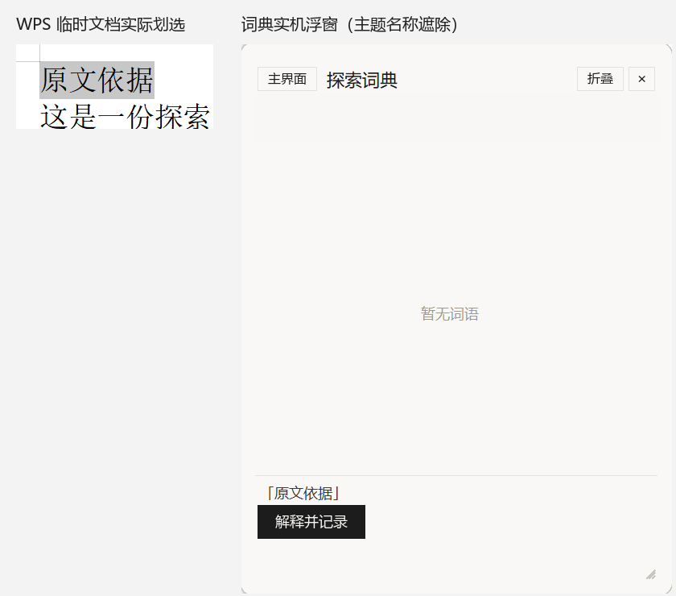

# Word 文档划词修复与桌面入口实测

2026-10-13。用户报告桌面快捷方式启动后仍无法读取 Word 文档划选；用户随后在自编临时 DOCX 中划选“原文依据”。本机默认打开应用为 WPS Office 12.1.0.24031，本记录不将它写成 Microsoft Word 实测。

## 复现与原因

修复前现有 helper 对真实选区返回 `ok=false, reason=no_textpattern`，焦点为 `KxWpsView`，正文属于另一个 wps.exe 进程。顶层窗口及同应用子进程身份核验已通过；当前正文没有 TextPattern，因此之前的跨进程修复不足以解决这次问题。修复前结果保存在 `uia-before.json`。只做 EXE 启动诊断不能证明划词可用。

通过正文原生 HWND 的 `AccessibleObjectFromWindow(OBJID_NATIVEOM)` 获得该文档窗口后，实际读取 `Window.Selection.Range.Text` 得到“原文依据”。最初诊断曾用已运行 COM 对象定位接口，产品实现使用正文 HWND 直接绑定，避免多窗口下全局活动对象选错文档。

## 修复与边界

源码提交：`5b30a2a66d865eff198c197548474f6435ba03d7`。正文未提供 TextPattern 时，对 Word/WPS 的 `_WwG` / `KxWpsView` 补充原生选区读取；只接受正常连续文本选区。空光标、块/形状选区和工具栏不进入此补充读取路径。上下文通过复制范围的端点扩展读取，不移动用户选区。取词来源方法保存为 `office_selection`。

绑定与读取前后核验当前前台、顶层 HWND/PID、正文 HWND 根窗口及所属进程映像/可读路径；取词服务原有游戏、全屏、暂停、页面世代及前后台身份校验继续生效。产品不发送 Ctrl+C、不使用剪贴板、不启动 Office 实例、不编辑文档。当前没有覆盖 Microsoft Word 实机、WPS 所有选区类型或其他阅读应用的验收。

## 真实快捷方式验证

入口为 `C:\Users\张哲铭\Desktop\探索词典.exe - 快捷方式.lnk`，目标仍为 `D:\探索工具\探索词典\探索词典.exe`。将更新后的 helper 同步到 `_runtime/scripts/uia_helper.ps1`；源码与部署脚本 SHA256 一致，具体值见 `receipt.json`。EXE 从所在目录加载磁盘 app；无需重打包，也未重写快捷方式或替换生产数据库。

实际通过该快捷方式启动词典，进程 PID=66248。只在自编临时 DOCX 内进行鼠标拖选，日志于 19:40:20 记录 `取到选区：「原文依据」（wps.exe，4 字，drag）`。截图确认浮窗显示“原文依据”和“解释并记录”按钮，前台仍为临时 WPS 文档。未点击解释按钮、未调用模型；检验前后生产词条和主题数量相同。验收图裁自真实截图，遮除了原有主题名称，不留存整个桌面或用户文档内容。

真实临时材料在 `.tmp/word-capture-20261013/取词测试-仅临时材料.docx`。词典保持运行，用户可以直接继续阶段验收。

## 回归与信息留存

104 项相关测试通过，包含新的 Office 来源标记/显式记录测试、取词身份及门控、来源归属、运行时恢复。新 PowerShell 合约测试实际执行产品函数，使用受控窗口/COM 提供者验证 17 项断言：正文选择、上下文偏移、原选区不变、插入点、块选区、返回对象窗口不符、前台改变、进程及路径不符等。该测试不启动真实 Office 或读取真实 UIA，不代替上述 WPS 实机验证。`regression.log` 中的 FakeRoot 诊断异常属于被覆盖的测试路径，整轮 unittest 结论为 OK。helper 语法解析通过；脚本继续保持纯 ASCII 和原 CRLF 行尾。

`receipt.json` 保存入口、源码提交、脱敏成功日志、范围、104 项回归结论和入口/源码/部署脚本哈希；`manifest.json` 保存证据文件 SHA256。生产数据库、密钥和完整生产日志均未纳入提交。

本轮成功直接读取 GitHub，远端 main 为 `6dc97c1b789d88fdd4ae51eede12baeead84660f`。本轮源码及验收文档提交完成后，本地领先该远端 24 条，未推送、未改写历史。全部未推送历史另存 `artifacts/all-unpushed-word-fix-20261013.bundle`，以远端提交为必要恢复基点；旧 bundle 仍保留，不能把旧文件当作包含本轮修复。
